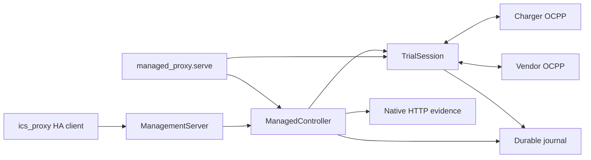

# Code navigation and review guide

This is the reading map for the standalone iCS proxy and its tests. Start from the requested source commit and
actual entry point. Historical names such as `prototype` and `TrialSession` do not mean that
their code is unused. This guide describes source relationships; it is not a live status report or a test result.

## Read first

1. [AGENTS.md](../AGENTS.md): project boundaries, English communication and the owner's operational constraints.
2. [README current operation](../README.md#current-ics-controls-and-32-a-operation): commissioned controls and limits.
3. This guide: the runtime, state boundaries and tests to follow.
4. [Recovery coverage](recovery-coverage.md): declared obligations, exclusions and physical-evidence limits.
5. [Developer guide](developer.md) and [release process](release-process.md): verification and deployment procedures
   when that work is requested. Reading them does not authorize running their commands.
6. [Changelog](../CHANGELOG.md): recent corrections and useful regression starting points. A complete review extends
   beyond those changes to all code and tests within its agreed scope.

## Runtime boundaries

| Component | Entry point and responsibility |
| --- | --- |
| Standalone service | [`tools/managed_proxy.py`](../tools/managed_proxy.py) owns the persistent session, supervision, management listener and status publication. `check` validates files offline. `health` reads saved status. `incident` reads the journal and optional Start observations. |
| Shared-core loader | [`tools/trial_proxy.py`](../tools/trial_proxy.py), `load_core()`: loads `custom_components/ocpp_hub/core/` as **`ocpp_hub_core`**, preserving relative imports without running the older HA integration. |
| Protocol/native engine | [`core/prototype/`](../custom_components/ocpp_hub/core/prototype/): the iCS implementation, plus its imports from shared `core/`. |
| Current HA client | [`custom_components/ics_proxy/`](../custom_components/ics_proxy/), `async_setup_entry()`: polls management and exposes controls, entities, notifications and diagnostics. It does not open the OCPP journal or own the charger connection. |
| Older HA integration | [`custom_components/ocpp_hub/__init__.py`](../custom_components/ocpp_hub/__init__.py): separate Raedian listener/integration. It is not the standalone service entry point. |



The diagram shows ownership and communication, not every call. The service creates `TrialSession` with the legacy
unscoped local Start disabled, then creates `ManagedController` and `ManagementServer`. Explicit guarded management
`start` is supported through `ManagedCharging`; do not mistake it for that disabled legacy Start.

Shared modules outside `prototype/` include `commands.py`, `control.py`, `frames.py`, `metering.py`, `model.py`,
`readings.py` and `session.py`. Follow actual imports and calls rather than excluding their parent directory.
TrialSession requires the explicit native-bounded specification for commissioning and managed operation. The plain
commissioning and experimental vehicle-pause modes are retired. Native evidence, actual cleanup and original-backend
restoration remain. The older HA layer and vendor mirror are a separate review domain; directory location alone does
not classify shared code as out of scope.

`TrialSession` constructs one native admission/introduction/recovery/cleanup owner. The old plain Recovery,
Rollback and StableObserver are removed; `trial_rollback.py` retains only shared lifecycle prerequisites. The
constructor refuses an admitted plain journal before resource setup, preserving its existing rows. A prepared
journal still receives full native admission. Native commissioning retains Start and Release; `_resource_mutation_inflight`
continues to protect daily supervision. The generic Gateway/resource test rig remains a boundary collaborator.

## Module map

Core filenames in this table are under `custom_components/ocpp_hub/core/prototype/`. Listed tests are starting points,
not a complete inventory: follow their imports, sibling cases, parameter generators and the coverage registry.

| Area | Main code to follow | Regression starting points under `tests/` |
| --- | --- | --- |
| Process and connections | [`trial_session.py`](../custom_components/ocpp_hub/core/prototype/trial_session.py), `TrialSession`; `trial_transport.py`; `runtime.py`, `ConnectionRuntime`; `tools/managed_proxy.py` | `test_managed_service_cli.py`, `test_service_observation_recovery.py`, `test_managed_boot_supersession.py` |
| Command decision order | [`command_processor.py`](../custom_components/ocpp_hub/core/prototype/command_processor.py), `CommandProcessor`; `Gateway` shares it with both peers, admission receipts, and local control | `test_command_processor.py`, `test_managed_start_reply_lifecycle_order.py`, `test_rpc_validation_deadlines.py` |
| OCPP dispatch and policy | [`gateway.py`](../custom_components/ocpp_hub/core/prototype/gateway.py), `Gateway`; `rpc.py`; `station.py`; `policy.py`; `ics.py`; `ics_writes.py`; shared frame/session code | `test_protocol_diagnostics.py`, `test_prototype_ics.py`, `test_prototype_ics_writes.py` |
| Management and intent | [`managed_api.py`](../custom_components/ocpp_hub/core/prototype/managed_api.py), `ManagementServer`; `managed_intent.py`, `ManagedRequests`; `managed.py`, `ManagedController.command()` | `test_managed_api.py`, `test_managed_controls.py`, `test_managed_return_exclusion.py` |
| Physical control authority | [`control_state.py`](../custom_components/ocpp_hub/core/prototype/control_state.py), `ControlState` and `Journal.control`; the sole serializer for ownership, holds, ticket completion and current/Start projections | `test_control_authority.py`, `test_bound_owner_retirement.py`, `test_release_publication.py` |
| Installation lifecycle | [`installation_lifecycle.py`](../custom_components/ocpp_hub/core/prototype/installation_lifecycle.py), `Journal.phase`; the sole phase/introduction-flag writer and shared phase predicates | `test_installation_lifecycle.py`, `test_persistence_bootstrap.py`, `test_native_bounded_handover.py` |
| Live supervision and health | [`managed.py`](../custom_components/ocpp_hub/core/prototype/managed.py), `_tick()`; `supervision.py`, pure authority/health assessment; `managed_view.py`, poll publication and socket refresh | `test_supervision.py`, `test_managed_proxy.py`, `test_managed_observed_freshness.py` |
| Recovery contracts and coordination | [`recovery_contracts.py`](../custom_components/ocpp_hub/core/prototype/recovery_contracts.py), prerequisites, call results, authority and owned effects; `recovery_policy.py`, pure recovery decisions and terminal progress; `recovery_coordinator.py`, `RecoveryCoordinator` | `test_recovery_contracts.py`, `test_release_publication.py`, `test_recovery_retirement.py` |
| Start lifecycle and settlement | [`start_lifecycle.py`](../custom_components/ocpp_hub/core/prototype/start_lifecycle.py), `StartLifecycle`, typed persisted identity, receipt/pending/metadata writes and the lease slot; `start_settlement.py`, pure failure/retirement policy, shared evidence and scoped candidates | `test_start_lifecycle.py`, `test_start_settlement.py`, `test_control_slice_peer.py` |
| Start and cancellation | [`managed_charging.py`](../custom_components/ocpp_hub/core/prototype/managed_charging.py), `ManagedCharging`; `managed_start_binding.py`; `managed_start_cancellation.py`; `start_handoff.py`; `local_control.py` | `test_managed_normal_start.py`, `test_managed_start_cancelled_outer.py`, `test_managed_start_child_commit.py` |
| Selected current and failed holds | [`managed_current.py`](../custom_components/ocpp_hub/core/prototype/managed_current.py), `ManagedCurrentLimits`; `managed_current_prepare.py`; `managed_current_recovery.py` | `test_managed_current.py`, `test_current_failed_idle_hold.py`, `test_current_failure_binding.py` |
| Native evidence and resources | [`native_bounded_handover.py`](../custom_components/ocpp_hub/core/prototype/native_bounded_handover.py), `NativeBoundedHandover`; `trial_evidence.py`, `NativeObserver`; `native_http.py`; `native_history.py`; `trial_resources.py`, `ResourceBook` | `test_native_read_supersession.py`, `test_native_optional_storage.py`, `test_native_repair_strict_conflict.py` |
| Persistence and cloud replies | [`store.py`](../custom_components/ocpp_hub/core/prototype/store.py), `Journal`; `delivery_reply.py`; `managed_start_delivery.py`; `managed_stop_delivery.py`; `vendor_read_recovery.py` | `test_stop_saved_reply_recovery.py`, `test_worker_storage_recovery.py`, `test_managed_start_delivery_recovery.py` |
| Command outcomes | [`command_outcomes.py`](../custom_components/ocpp_hub/core/prototype/command_outcomes.py), `Journal.outcomes`; exact owner and forwarded wire steps, reply settlement, independent session proof and the current cloud delivery outcome. | `test_vendor_dispatch.py`, `test_pause_stop_recovery.py`, `test_real_process_death.py` |
| Pause, Return and recovery | [`managed.py`](../custom_components/ocpp_hub/core/prototype/managed.py), `maintain_pause()`, `return_requested()`, `tick()`; `recovery_coordinator.py`, `advance()` and `restore()`; `ordinary_recovery.py`; `managed_recovery.py`; specialized `managed_*_recovery.py` siblings | `test_pause_stop_recovery.py`, `test_managed_offline_recovery.py`, `test_combined_recovery_proofs.py` |
| Status and diagnostics | [`managed_view.py`](../custom_components/ocpp_hub/core/prototype/managed_view.py), `health_snapshot()`; `managed_diagnostics.py`, `snapshot()`; [`tools/managed_reporting.py`](../tools/managed_reporting.py), `Reporting` | `test_managed_diagnostics.py`, `test_diagnostic_contracts.py`, `test_start_diagnostic_progress.py` |
| HA API and lifecycle | [`ics_proxy/api.py`](../custom_components/ics_proxy/api.py), `ProxyClient`; `coordinator.py`, `ProxyCoordinator`; `notification.py`; entity and diagnostic modules | [`tests_ha_proxy/`](../tests_ha_proxy/): `test_freshness_recovery.py`, `test_current.py`, `test_diagnostics.py`, `test_inflight_lifecycle.py` |

Read recovery siblings alongside their callers. The small modules divide proof and settlement across files; a
function that returns successfully may only advance one boundary, leaving an actual command or receipt pending.

`TrialSession` creates one `CommandProcessor` and `ManagedController` uses that same instance. The queue runs short
synchronous decisions for command claims, send checks, incoming charger reports, matched replies, and native
observations. Pause and other protective decisions have priority. Ordinary decisions at the same priority keep
queue order. Socket reads, sends and native HTTP waits run outside the queue. The peer matches a reply to its request
as it arrives. The queue then lets the request owner record the result and check the original Boot, ticket and
session before publishing any change in authority. Start and Stop replies record what the peer confirmed.
Lifecycle reports and independent observations establish what the charger actually did.

`Journal.outcomes` supplies the same evidence to supervision, recovery and status. It preserves the original
owner request, exact wire call, charger reply and the local session when a real lifecycle report binds it.
An owner request can have several wire calls. The selected current and a rollback to zero have separate
replies. A pending write, an unanswered call and a known reply waiting for physical proof have different meanings.
Older receipts keep their original layout and are read with the evidence they actually contain.

`Journal.control` is the only production writer of the existing physical-authority record. `ControlState` preserves
raw extra fields and missing-key defaults; its shared/hold predicates distinguish legacy truthy flags from explicit
Boolean proof. Admission replaces the record; claim, hold, current selection and Start projection transitions merge
the caller's existing preimage. Exact-ticket completion cannot publish a late result over a newer Pause. Callers
keep their transactions and fresh physical checks; the owner adds no cache, migration, socket or transaction.

`Journal.phase` owns the existing `trial_phase` and `trial_starting` keys. `read()` samples only the phase into an
`InstallationState`; `starting` remains a separate lazy read with its original raw truthiness. Named predicates
share active, operating, supervised, held, cleanup and legacy admission checks without interpreting a snapshot as
permission. Phase-only transitions add no physical hold. Compound restriction, fault, local resume and fault
retirement preserve their supplied control preimages and ordered writes inside the caller's transaction.
Resource faults retain cleanup while managed faults block only supervised phases. The resource send guard keeps
its local zero-only phase override; it does not persist activation. Unknown stored JSON and absent legacy phases
retain their existing comparison and status meanings.

`current_control_scope()` in `connection_scope.py` captures the exact authenticated Boot and control revision;
`control_scope_matches()` reconstructs that identity at every dispatch or publication check. Missing observations
never match. `ManagedController.authority()` adds the existing intent and ticket for full result/publication
identity. These values are observations, not reusable permission. Narrower Stop, fault-zero and current-worker
guards keep their existing epoch/Boot rules, since adding a metadata fence could prevent a legitimate restriction.

The main poll reads top to bottom: settle owned work, maintain faults, supervise recovery/native evidence, assess
authority, publish a view. `_supervise()` keeps native and recovery effects explicit. The poll and API both use
`ControlProof` in `supervision.py` to keep the observed shared grant or physical zero only while the matching
authority remains current. An unsettled delivery blocks readiness while a verified zero can remain visible.
The controller still owns the fault latch and Return completion. It decodes cloud grants only after local
readiness. Live command and commit guards recheck their own evidence. Pending and observed status share common
fields in `managed_view.py`.

`Journal.starts` is the synchronous Start lifecycle owner; pending-bit updates use `Journal.control`. It reads
the existing journal keys into a typed
`ChargeStart`, treats the current wire receipt as canonical, and checks metadata projections before correlating
local closure. Published acceptance, actual wire outcome, stored pending obligation and the current in-memory
lease remain distinct. Normal, timed and cloud tests share the metadata key, so their writes pass through this
owner. Generic `ManagedRequests` startup still marks unfinished request rows `process_replaced`; it restores no
lease or positive permission.

`start_settlement` holds the pure failure and caller-named retirement policies. `ChargeStart` preserves raw
legacy markers and opaque result bytes. Preflight, unissued-at-zero, closed-at-zero, generic test settlement and
cancelled-unprepared rules retain different evidence and update contracts; the selector does not choose a priority
between them. `RetirementCandidate` freezes only the original rule's preimage. Generic settlement includes its
selected session and exact lease identity; cancellation uses raw receipt bytes; closed-zero also pins pending.
`Journal.starts.retire` applies the selected outcome through one filtered request writer. The async caller retains
native proof, task/cancellation ownership, restrictive execution and post-COMMIT memory changes. Local completion
never consumes independent cloud delivery debt.

`managed_intent.py` owns control-intent serialization and Pause/Return request transitions. All domain intent
writes use `write_intent`, including admission-time recovery on a bare journal; that function performs no request
startup sweep. Its pure `ControlIntent.next` advances revisions or explicitly coalesces legacy read recovery.
`ManagedRequests` shares the transaction/current-intent check for Start and Return app publication,
while their separate request outcomes and original callback order remain. The management driver claims Return
after busy/stopping waits and before completion launch; direct restore keeps its accepted-before-publication
contract. Queue refusal records uncertainty, and the owned completion settles later waits or
failures. Controller/native/send guards, owner Pause/Stop markers, independent cloud debt and task lifetime remain
separate responsibilities. `test_control_lifecycle.py` covers stored transitions and real SQL/COMMIT rollback;
`test_control_lifecycle_peer.py` covers actual scheduling, capacity and the retained legacy healthy-status path.

The former control grammar and boundary observer are test references under `tests_model/control_slice.py`,
`control_slice_state.py` and `start_reference.py`. Production has no observer callback or dependency on those
modules. Their original tests remain, alongside real peer and process-death checks of the production owner.
See the [developer guide](developer.md#control-transitions-and-start-settlement) for the stored-state contract.

`managed_settlement.py` binds terminal current records, owner-held Start candidates and internal Pause claims to
caller-owned zero proofs. `managed_release_recovery.py` verifies the current Pause, closed native zero, original
daily timetable and owned station receipt before retiring a fault. Start with
`test_managed_settlement_regressions.py` for real-peer recovery and storage-failure cases. `test_runtime_boot_retry.py`
covers repeated read-only probes; `test_managed_cached_authorization.py` and
`test_managed_cloud_pending_return.py` cover cloud decisions, retained permissions and timed-test Return settlement.
`test_managed_start_authorization.py` covers guarded normal-Start renewal of aged Accepted tags through actual
upstream TLS replies, refusals and superseding authority. The existing HA control-mode diagnostic explains
authorization readiness without changing physical health.

For introduction, follow `TrialSession._before_ceiling()`, `NativeBoundedHandover.introduce()` and the runtime's
typed deferred retry loop. `audited_epoch` records completed admission auditing; `introduced_epoch` and
`introduced_revision` record completed setup under the current authority. `introduction_pending` includes live
native bodies and the runtime's introduction service through probe creation, retry sleeps and joined retirement.
Ordinary zero repair cannot publish completion while that work remains pending. A newer Pause may use audited
provenance only after the work retires and its own fresh closed-zero proof succeeds. Completed setup alone does
not prove zero or publish shared authority. `managed_faults.py` shares the strict diagnostic latch with ordinary
supervision.
`test_introduction_readiness_retry.py` separates pending prerequisites from simultaneous content contradictions;
`test_introduction_completion.py` covers foreground zero, a newer Pause and the retry-sleep gap at 6 A and 32 A.
`test_introduction_write_retry.py` injects real post-read SQLite write failures into the replay-safe prefix;
later Stop-capable work stays outside that retry boundary.
For command timing, follow `Peer._validate()` through its priority gate and then the independent send/reply deadline;
`test_rpc_validation_deadlines.py` covers preemption before dispatch and retained uncertainty after dispatch.

`connection_scope.py` separates introduction lineage from exact Boot-bound cloud
and resume evidence. `recovery_contracts.py` separates a named pending prerequisite,
a particular RPC's `Reply`/`NotSent`, exact authority and the whole owned release's
physical and publication facts. `release_attempt.py` builds those facts through
later reads and rollback; `recovery_policy.py` makes the shared pure decision.
A pending last call does not mean an earlier positive profile was never sent.
Legacy Frame/require adapters translate pending data only at compatibility edges;
business recovery does not classify exception messages or cause chains.

`recovery_coordinator.py` owns common preflight, release, result interpretation and
completion. Current, ordinary, expired-Start and connection callers consume
`RestoreProgress` before settling their own records. Domain obligations can coexist;
visiting one during a poll does not discharge another. An authority snapshot never
permits a later send: the executor checks current intent, Boot, revision and ticket
at the actual effect and SQL publication boundaries.

`RecoveryCoordinator._run_restore` directly sequences initial observation/check, optional recovery, verified
observation and required recheck before release. A Pending ends this attempt. The existing
recovery policy maps release disposition to terminal progress; claimed-zero acknowledgement and fault effects stay
in the driver. Initial closure/session checks, post-resume ticket capture, final native proof and every live
send/publication guard keep their original order. `test_recovery_contracts.py` covers terminal mapping; real HTTP
and SQLite witnesses in preflight, retirement and publication tests establish the independent effect boundaries.

`ResourceBook.confirmed_station_zero` compares the caller's already selected native station with its confirmed
resource receipt. Seven consumers share that predicate while keeping their distinct profile filters, SQL reads,
early lifecycle waits and error policy. It decodes receipt JSON only when called at the original Boolean position.
The weaker cleanup presence check also belongs to ResourceBook. Neither check grants a send or Stop permission.

`ReleaseHandoff` joins final release metadata, explicit Return intent/receipt and
shared control in the wire child's transaction. `start_handoff.py` similarly joins
normal Start's app intent and awaiting-power lease with shared control, after its
real Accepted evidence commits separately. Memory publication follows successful
COMMIT. A completed publication overtaken by a newer owner event is stale; its old
caller cannot overwrite the new authority or relabel that successful publication
as a fresh release fault. An Accepted Start is not proof of charging or permission
to discard its lifecycle/cloud debt.

Follow `Peer.call_result()`/`sequence_results()` and their legacy wrappers into the
same `_call_locked()` transport. Native and resource guards must forward pending
results before resource intent or dispatch; completed strict verdicts and cleanup
storage failures retain precedence. Read `trial_session.py` and `local_control.py`
together for retirement: closing revokes positive permission, owned completion and
wire tasks finish before SQLite closes, and repeated caller cancellation cannot
abandon cleanup. `retired_schedules.py` reads old one-off records before journal initialization; unfinished
physical or report obligations refuse startup without rewriting evidence. Completed plan IDs remain reserved.

Useful boundary tests include `test_managed_introduction_scope.py`,
`test_release_positive_effect_retention.py`
and `test_rpc_native_cleanup_failure.py`. For Start, follow
`test_managed_return_during_start.py`, `test_managed_return_after_start_child.py`,
`test_managed_return_after_start_boot.py` and `test_managed_start_reply_lifecycle_order.py`
through actual reply, SQL publication, newer Pause and lifecycle closure. A private
function entry alone does not establish which of those boundaries occurred.

## Follow a control through every boundary

- **Start/current:** HA entity → `ProxyClient.request()` → `ManagementServer` → `ManagedController.command()` →
  managed request/intent → preparation and native proof → actual RPC → real reply/lifecycle → durable completion →
  subsequent status/receipt polling. Check replacement, cancellation and a newer Pause at each awaited boundary.
- **Pause/Return:** distinguish accepting a request from proving closed zero and from a permitted positive release.
  Follow `ManagedRequests`, current intent/revision, exact owned profile, Boot binding, native evidence and cloud
  delivery debt. A completed old receipt must not establish a newer operation's result.
- **Cloud delivery:** `Gateway`/runtime → journal queue and transaction mapping → actual vendor response → stored
  reply → acknowledgement transaction. Unknown Start delivery differs from an explicit refusal. Follow recovery
  through a second ordinary session or outage; reaching zero is only one obligation.
- **Native observation:** HTTP framing/JSON → complete native snapshot → configuration/history/resource checks →
  current Boot and request association → public readiness. A temporary read failure, superseded snapshot and a
  validated ownership mismatch have different recovery behavior.
- **Diagnostics:** core facts → optional reporting/storage → management status → HA freshness and explanation.
  Optional reporting failure must not prevent required control settlement. Cached or absent evidence stays unknown.

Intent, selected current, effective station offer and measured current are different values. Local readiness and
cloud connectivity are also separate facts. Follow these distinctions through the database and HA rendering.
The journal's requests, allocation, mappings, queued events, saved replies, mutation receipts and history survive
process replacement; process-local tasks and cached observations need fresh evidence. Do not infer completion from
task exit, a non-error response or an earlier healthy snapshot.

## Tests and their support code

| Root | What to inspect |
| --- | --- |
| [`tests/`](../tests/) | Ordinary engine, service/subprocess, persistence, protocol and tool tests. Filter by actual review scope, not only filename. Registered finite families can live here too. |
| [`tests_model/`](../tests_model/) | Finite generators, cases, obligations and sequence tests. [`catalog.py`](../tests_model/catalog.py) `FAMILIES` identifies test ownership; [`coverage.py`](../tests_model/coverage.py) `RISKS` links obligations, focused checks and limits. |
| [`tests_discovery/`](../tests_discovery/) | Explicit offline search and replay for overlapping recovery steps. The simulator witnesses actual messages and committed SQLite records. |
| [`tests_installation/`](../tests_installation/) | Explicit simulated week with Home Assistant, a retained charger timetable, and two proxy builds sharing one migrated journal. |
| [`tests_ha_proxy/`](../tests_ha_proxy/) | Actual HA client lifecycle, polling, receipts, freshness, diagnostics and current/schedule behavior. These same files run in both supported client runtimes. |
| [`tests_ha/`](../tests_ha/) | Older `ocpp_hub` HA integration. Keep its results and review scope separate from the thin client. |
| [`tools/parallel_qualify.py`](../tools/parallel_qualify.py) and evidence helpers | Suite definitions, frozen inputs and meaning of qualification results. Include these when reviewing the test/evidence machinery; reading them does not require launching workers. |

Read each root's `conftest.py`. The engine alias is initialized by `tests/conftest.py`; model tests reuse it. Important
shared helpers include `trial_helpers.py`, `managed_scenario_helpers.py`, `service_recovery_helpers.py`,
`recovery_barriers.py`, `process_helpers.py`, `process_service_child.py`, `peer_start_ledger.py` and `worker_ports.py`
under `tests/`. Inspect `fake_charger.py`, `fake_vendor.py` and `prototype_firmware.py` for independent peer behavior.
Follow other imported helpers too. A shared setup shortcut can weaken many apparently independent tests.

| Support owner | Responsibility and compatibility boundary |
| --- | --- |
| `tests/connected_rig.py`, `tests/trial_peer.py` | Independent native HTTP and TLS peers. `connected_bench` accepts the native peer and bench classes explicitly. |
| `tests/managed_rig.py`, `tests/charge_rig.py`, `tests/current_rig.py` | Managed session, charging lifecycle and current commissioning rigs. `healthy` drives controller ticks. A service test's `RunningService.published` observes the running service's status. |
| `tests/native_schedule_support.py` | Independent native plan peer, calendar, `TimerBench` and `timer_bench(peer_type=..., bench_type=...)`. The peer models the retained original native daily schedule. |
| `tests/peer_mutation_helpers.py` | Actual peer refusal or application followed by a delayed reply, complete physical-profile observations and unchanged forwarding of real TLS replies. Optional release witnesses do not alter existing zero/Stop/clear callers. |
| `tests/release_outcome_helpers.py` | Whole-release effect assertions and explicitly requested owner Pause/closure/Return recovery. Assertions do not silently issue owner commands to repair an unexpected fault. |
| `tests/recovery_barriers.py` | Exact request UUID/revision, physical condition and completion checks; a generic healthy snapshot is not completion of a named request. |
| `tests/native_fault_support.py` | Actual HTTP gates and read-only coroutine witnesses. A moved implementation requires a new selector witness, not a skipped failure cut. |
| `tests/test_introduction_storage_retry.py` | Owns the independent `GatedIntroductionPeer` HTTP gate and `current_probe` task witness, also used by `test_introduction_completion.py`. The witness observes the real probe without replacing its result. |

Inspect failure injection and the oracle independently: what actually failed, whether the peer changed, which reply
arrived, whether the database rolled back, and what proves later recovery. Include setup, timeout, teardown and
subprocess exit checks. Parameter counts describe a declared finite grammar, not every possible history; use the
source registry and [coverage matrix](recovery-coverage.md) for counts and exclusions rather than copying totals here.

The four large stored captures in [`tests/fixtures/`](../tests/fixtures/) have current consumers in
`test_prototype_ics.py`, `test_prototype_ics_writes.py` and `test_prototype_recorded_runtime.py`. Preserve their bytes
and inspect provenance, parser/consumer assumptions and assertions. Record whether the capture itself was fully
read or only its format, provenance and consumers were checked. Do not silently omit it or claim full inspection.

## Review checkpoints

Start with read-only source identity and inventory; do not run service entry points, tests or collection to discover
the code. A review request does not authorize twenty-worker qualification, deployment or live charging tests.

```sh
git rev-parse HEAD
git status --short
git ls-files tools custom_components tests tests_model tests_ha_proxy tests_ha
```

Keep a checkpoint outside the repository unless a task explicitly requests a durable repository document:

| File or group | Status | Evidence and remaining work |
| --- | --- | --- |
| Exact source path | Unread / partial / reviewed / excluded | Symbols or line sections inspected; related tests/helpers; remaining sections; explicit reason for exclusion. |

1. Record the full commit, dirty state, deployed/reviewed scope and runtime entry points. Resolve any difference
   between the requested push and the local checkout before making source-specific claims.
2. Inventory every reachable runtime file and every relevant test/support file. Expand imports, generators and
   fixture consumers; the module table and risk matrix are starting points, not permission to skip other files.
3. Review one coherent flow with its state transitions, failure paths and test oracles. Retain precise unread
   sections when pausing, especially in large modules and captures.
4. Resume from the checkpoint until the inventory is accounted for. Report partial review honestly, with remaining
   files and exclusions. A clean findings list alone is not a coverage claim.
5. Validate each finding against the current code and a concrete reachable sequence. Distinguish a confirmed defect,
   a coverage gap and an unproven possibility. Use plain operational language and state the practical consequence.

Keep checkpoints, reproduction scripts and reports in the owner's task directory, not beside source files. Update
this map and its links when moving an entry point, changing a runtime boundary or adding a test family. Keep current
operating instructions distinct from historical evidence in README and the roadmap.
