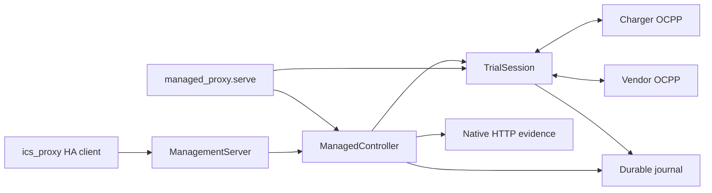

# Code navigation and review guide

This is the reading map for the standalone iCS proxy and its tests. Start from the requested source commit and
actual entry point. Historical names such as `prototype`, `TrialSession` and `ManagedChargeTests` do not mean that
their code is unused. This guide describes source relationships; it is not a live status report or a test result.

## Read first

1. [AGENTS.md](../AGENTS.md): project boundaries, English communication and the owner's operational constraints.
2. [README current operation](../README.md#current-ics-controls-and-32-a-operation): commissioned controls and limits.
3. This guide: the runtime, state boundaries and tests to follow.
4. [Recovery coverage](recovery-coverage.md): declared obligations, exclusions and physical-evidence limits.
5. [Developer guide](developer.md) and [release process](release-process.md): verification and deployment procedures
   when that work is requested. Reading them does not authorize running their commands.
6. [Changelog](../CHANGELOG.md): recent corrections and useful regression starting points. A complete review extends
   beyond those changes to all code and tests within its agreed scope.

## Runtime boundaries

| Component | Entry point and responsibility |
| --- | --- |
| Standalone service | [`tools/managed_proxy.py`](../tools/managed_proxy.py), `serve()`: owns the persistent session, supervision, management listener and status publication. `check` validates files offline; `health` reads saved status. |
| Shared-core loader | [`tools/trial_proxy.py`](../tools/trial_proxy.py), `load_core()`: loads `custom_components/ocpp_hub/core/` as **`ocpp_hub_core`**, preserving relative imports without running the older HA integration. |
| Protocol/native engine | [`core/prototype/`](../custom_components/ocpp_hub/core/prototype/): the iCS implementation, plus its imports from shared `core/`. |
| Current HA client | [`custom_components/ics_proxy/`](../custom_components/ics_proxy/), `async_setup_entry()`: polls management and exposes controls, entities, notifications and diagnostics. It does not open the OCPP journal or own the charger connection. |
| Older HA integration | [`custom_components/ocpp_hub/__init__.py`](../custom_components/ocpp_hub/__init__.py): separate Raedian listener/integration. It is not the standalone service entry point. |



The diagram shows ownership and communication, not every call. The service creates `TrialSession` with the legacy
unscoped local Start disabled, then creates `ManagedController` and `ManagementServer`. Explicit guarded management
`start` is supported through `ManagedChargeTests`; do not mistake it for that disabled legacy Start.

Shared modules outside `prototype/` include `commands.py`, `control.py`, `frames.py`, `metering.py`, `model.py`,
`readings.py` and `session.py`. Follow actual imports and calls rather than excluding their parent directory.
Imports also load some commissioning/vehicle-pause helpers whose branches are not selected by normal native-bounded
operation. Mark those distinctions explicitly. The older HA layer and vendor mirror are a separate review domain;
their directory location alone does not classify shared code as out of scope.

## Module map

Core filenames in this table are under `custom_components/ocpp_hub/core/prototype/`. Listed tests are starting points,
not a complete inventory: follow their imports, sibling cases, parameter generators and the coverage registry.

| Area | Main code to follow | Regression starting points under `tests/` |
| --- | --- | --- |
| Process and connections | [`trial_session.py`](../custom_components/ocpp_hub/core/prototype/trial_session.py), `TrialSession`; `trial_transport.py`; `runtime.py`, `ConnectionRuntime`; `tools/managed_proxy.py` | `test_managed_service_cli.py`, `test_service_observation_recovery.py`, `test_managed_boot_supersession.py` |
| OCPP dispatch and policy | [`gateway.py`](../custom_components/ocpp_hub/core/prototype/gateway.py), `Gateway`; `rpc.py`; `station.py`; `policy.py`; `ics.py`; `ics_writes.py`; shared frame/session code | `test_protocol_diagnostics.py`, `test_prototype_ics.py`, `test_prototype_ics_writes.py` |
| Management and intent | [`managed_api.py`](../custom_components/ocpp_hub/core/prototype/managed_api.py), `ManagementServer`; `managed_intent.py`, `ManagedRequests`; `managed.py`, `ManagedController.command()` | `test_managed_api.py`, `test_managed_controls.py`, `test_managed_return_exclusion.py` |
| Start and cancellation | [`managed_test_charge.py`](../custom_components/ocpp_hub/core/prototype/managed_test_charge.py), `ManagedChargeTests`; `managed_start_binding.py`; `managed_start_cancellation.py`; `local_control.py` | `test_managed_normal_start.py`, `test_managed_start_cancelled_outer.py`, `test_managed_start_binding.py` |
| Selected current and failed holds | [`managed_current.py`](../custom_components/ocpp_hub/core/prototype/managed_current.py), `ManagedCurrentLimits`; `managed_current_prepare.py`; `managed_current_recovery.py` | `test_managed_current.py`, `test_current_failed_idle_hold.py`, `test_current_failure_binding.py` |
| Native evidence and resources | [`native_bounded_handover.py`](../custom_components/ocpp_hub/core/prototype/native_bounded_handover.py), `NativeBoundedHandover`; `trial_evidence.py`, `NativeObserver`; `native_http.py`; `native_history.py`; `trial_resources.py`, `ResourceBook` | `test_native_read_supersession.py`, `test_native_optional_storage.py`, `test_native_repair_strict_conflict.py` |
| Persistence and cloud replies | [`store.py`](../custom_components/ocpp_hub/core/prototype/store.py), `Journal`; `delivery_reply.py`; `managed_start_delivery.py`; `managed_stop_delivery.py`; `vendor_read_recovery.py` | `test_stop_saved_reply_recovery.py`, `test_worker_storage_recovery.py`, `test_managed_start_delivery_recovery.py` |
| Pause, Return and recovery | [`managed.py`](../custom_components/ocpp_hub/core/prototype/managed.py), `maintain_pause()`, `return_requested()`, `tick()`; `ordinary_recovery.py`; `managed_recovery.py`; specialized `managed_*_recovery.py` siblings | `test_pause_stop_recovery.py`, `test_managed_offline_recovery.py`, `test_combined_recovery_proofs.py` |
| Native timers and deadlines | [`managed_schedule.py`](../custom_components/ocpp_hub/core/prototype/managed_schedule.py), `ManagedSchedule`; `managed_cutoffs.py`; `managed_occurrences.py`; `schedule_time.py` | `test_managed_schedule_source_boot.py`, `test_managed_schedule_idle_cutoff.py`, `test_managed_deadline_source_wakeup.py` |
| Status and diagnostics | [`managed_view.py`](../custom_components/ocpp_hub/core/prototype/managed_view.py), `health_snapshot()`; `managed_diagnostics.py`, `snapshot()`; [`tools/managed_reporting.py`](../tools/managed_reporting.py), `Reporting` | `test_managed_diagnostics.py`, `test_diagnostic_contracts.py`, `test_start_diagnostic_progress.py` |
| HA API and lifecycle | [`ics_proxy/api.py`](../custom_components/ics_proxy/api.py), `ProxyClient`; `coordinator.py`, `ProxyCoordinator`; `notification.py`; entity and diagnostic modules | [`tests_ha_proxy/`](../tests_ha_proxy/): `test_freshness_recovery.py`, `test_current.py`, `test_diagnostics.py`, `test_inflight_lifecycle.py` |

Read recovery siblings alongside their callers. The small modules divide proof and settlement across files; a
function that returns successfully may only advance one boundary, leaving an actual command or receipt pending.

For introduction, follow `TrialSession._before_ceiling()`, `NativeBoundedHandover.introduce()` and the runtime's
typed deferred retry loop. `managed_faults.py` shares the strict diagnostic latch with ordinary supervision.
`test_introduction_readiness_retry.py` separates pending prerequisites from simultaneous content contradictions.
For command timing, follow `Peer._validate()` through its priority gate and then the independent send/reply deadline;
`test_rpc_validation_deadlines.py` covers preemption before dispatch and retained uncertainty after dispatch.

## Follow a control through every boundary

- **Start/current:** HA entity → `ProxyClient.request()` → `ManagementServer` → `ManagedController.command()` →
  managed request/intent → preparation and native proof → actual RPC → real reply/lifecycle → durable completion →
  subsequent status/receipt polling. Check replacement, cancellation and a newer Pause at each awaited boundary.
- **Pause/Return:** distinguish accepting a request from proving closed zero and from a permitted positive release.
  Follow `ManagedRequests`, current intent/revision, exact owned profile, Boot binding, native evidence and cloud
  delivery debt. A completed old receipt must not establish a newer operation's result.
- **Cloud delivery:** `Gateway`/runtime → journal queue and transaction mapping → actual vendor response → stored
  reply → acknowledgement transaction. Unknown Start delivery differs from an explicit refusal. Follow recovery
  through a second ordinary session or outage; reaching zero is only one obligation.
- **Native observation:** HTTP framing/JSON → complete native snapshot → configuration/history/resource checks →
  current Boot and request association → public readiness. A temporary read failure, superseded snapshot and a
  validated ownership mismatch have different recovery behavior.
- **Diagnostics:** core facts → optional reporting/storage → management status → HA freshness and explanation.
  Optional reporting failure must not prevent required control settlement. Cached or absent evidence stays unknown.

Intent, selected current, effective station offer and measured current are different values. Local readiness and
cloud connectivity are also separate facts. Follow these distinctions through the database and HA rendering.
The journal's requests, allocation, mappings, queued events, saved replies, mutation receipts and history survive
process replacement; process-local tasks and cached observations need fresh evidence. Do not infer completion from
task exit, a non-error response or an earlier healthy snapshot.

## Tests and their support code

| Root | What to inspect |
| --- | --- |
| [`tests/`](../tests/) | Ordinary engine, service/subprocess, persistence, protocol and tool tests. Filter by actual review scope, not only filename. Registered finite families can live here too. |
| [`tests_model/`](../tests_model/) | Finite generators, cases, obligations and sequence tests. [`catalog.py`](../tests_model/catalog.py) `FAMILIES` identifies test ownership; [`coverage.py`](../tests_model/coverage.py) `RISKS` links obligations, focused checks and limits. |
| [`tests_ha_proxy/`](../tests_ha_proxy/) | Actual HA client lifecycle, polling, receipts, freshness, diagnostics and current/schedule behavior. These same files run in both supported client runtimes. |
| [`tests_ha/`](../tests_ha/) | Older `ocpp_hub` HA integration. Keep its results and review scope separate from the thin client. |
| [`tools/parallel_qualify.py`](../tools/parallel_qualify.py) and evidence helpers | Suite definitions, frozen inputs and meaning of qualification results. Include these when reviewing the test/evidence machinery; reading them does not require launching workers. |

Read each root's `conftest.py`. The engine alias is initialized by `tests/conftest.py`; model tests reuse it. Important
shared helpers include `trial_helpers.py`, `managed_scenario_helpers.py`, `service_recovery_helpers.py`,
`recovery_barriers.py`, `process_helpers.py`, `process_service_child.py`, `peer_start_ledger.py` and `worker_ports.py`
under `tests/`. Inspect `fake_charger.py`, `fake_vendor.py` and `prototype_firmware.py` for independent peer behavior.
Follow other imported helpers too. A shared setup shortcut can weaken many apparently independent tests.

Inspect failure injection and the oracle independently: what actually failed, whether the peer changed, which reply
arrived, whether the database rolled back, and what proves later recovery. Include setup, timeout, teardown and
subprocess exit checks. Parameter counts describe a declared finite grammar, not every possible history; use the
source registry and [coverage matrix](recovery-coverage.md) for counts and exclusions rather than copying totals here.

The four large stored captures in [`tests/fixtures/`](../tests/fixtures/) have current consumers in
`test_prototype_ics.py`, `test_prototype_ics_writes.py` and `test_prototype_recorded_runtime.py`. Preserve their bytes
and inspect provenance, parser/consumer assumptions and assertions. Record whether the capture itself was fully
read or only its format, provenance and consumers were checked. Do not silently omit it or claim full inspection.

## Review checkpoints

Start with read-only source identity and inventory; do not run service entry points, tests or collection to discover
the code. A review request does not authorize twenty-worker qualification, deployment or live charging tests.

```sh
git rev-parse HEAD
git status --short
git ls-files tools custom_components tests tests_model tests_ha_proxy tests_ha
```

Keep a checkpoint outside the repository unless a task explicitly requests a durable repository document:

| File or group | Status | Evidence and remaining work |
| --- | --- | --- |
| Exact source path | Unread / partial / reviewed / excluded | Symbols or line sections inspected; related tests/helpers; remaining sections; explicit reason for exclusion. |

1. Record the full commit, dirty state, deployed/reviewed scope and runtime entry points. Resolve any difference
   between the requested push and the local checkout before making source-specific claims.
2. Inventory every reachable runtime file and every relevant test/support file. Expand imports, generators and
   fixture consumers; the module table and risk matrix are starting points, not permission to skip other files.
3. Review one coherent flow with its state transitions, failure paths and test oracles. Retain precise unread
   sections when pausing, especially in large modules and captures.
4. Resume from the checkpoint until the inventory is accounted for. Report partial review honestly, with remaining
   files and exclusions. A clean findings list alone is not a coverage claim.
5. Validate each finding against the current code and a concrete reachable sequence. Distinguish a confirmed defect,
   a coverage gap and an unproven possibility. Use plain operational language and state the practical consequence.

Keep checkpoints, reproduction scripts and reports in the owner's task directory, not beside source files. Update
this map and its links when moving an entry point, changing a runtime boundary or adding a test family. Keep current
operating instructions distinct from historical evidence in README and the roadmap.
